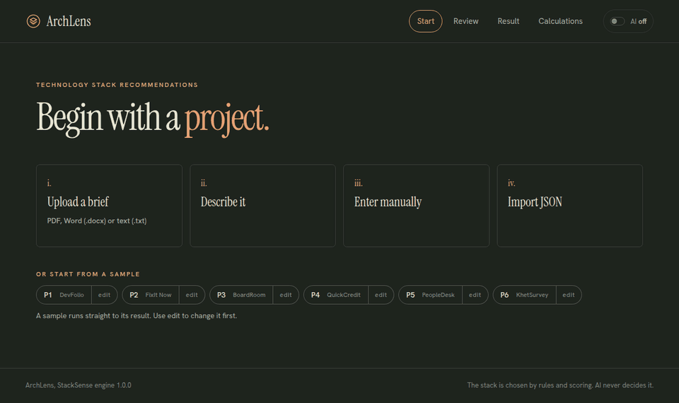
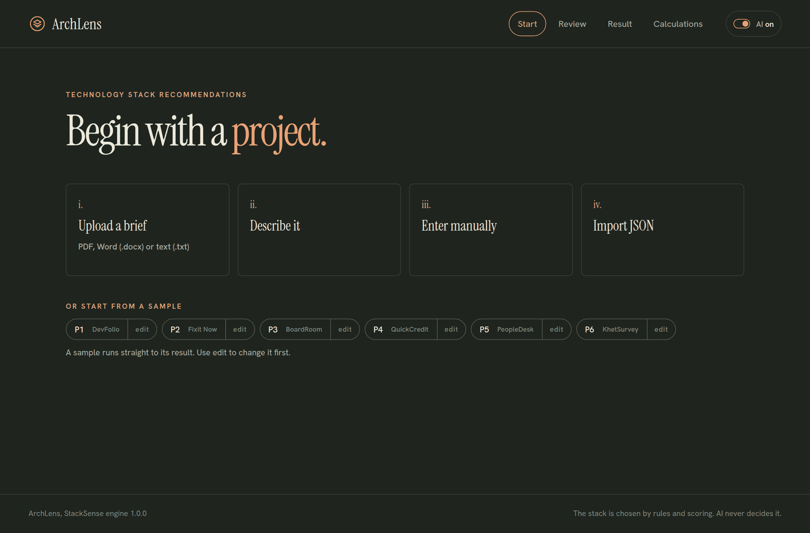
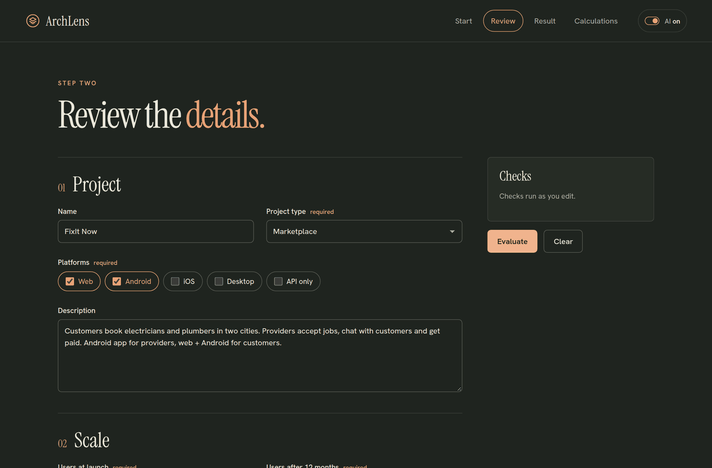
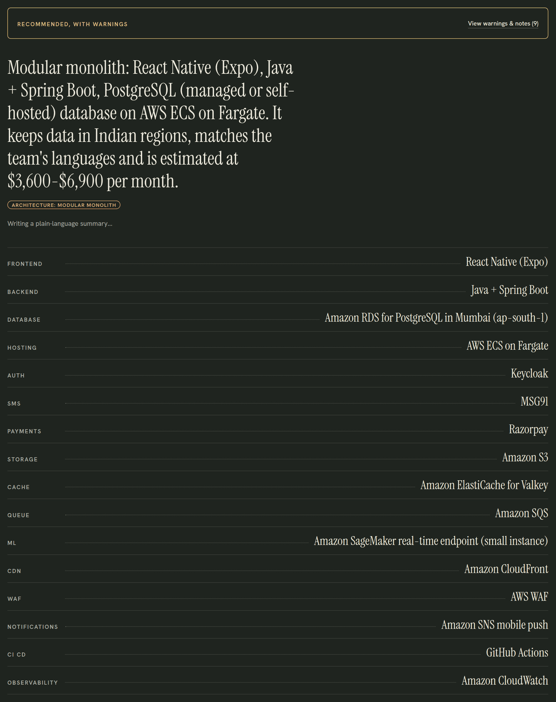
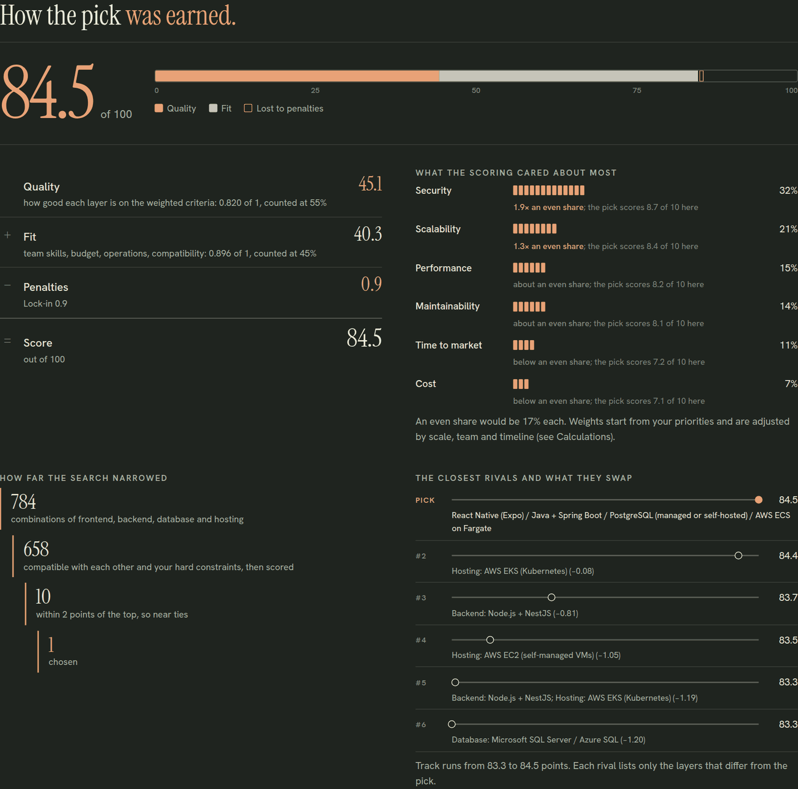
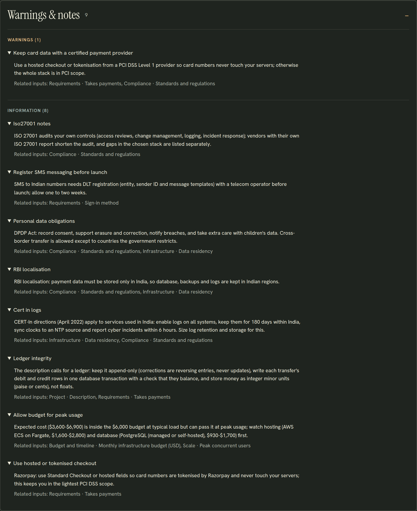
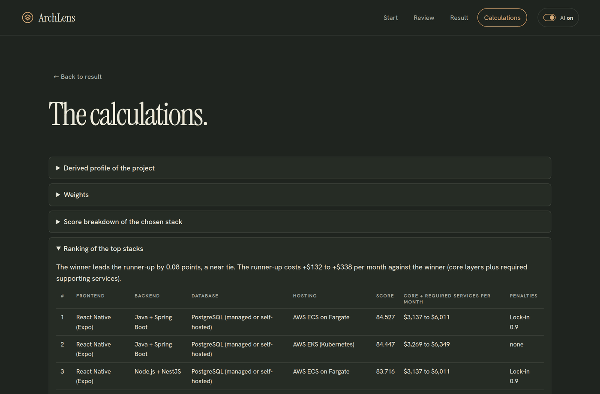
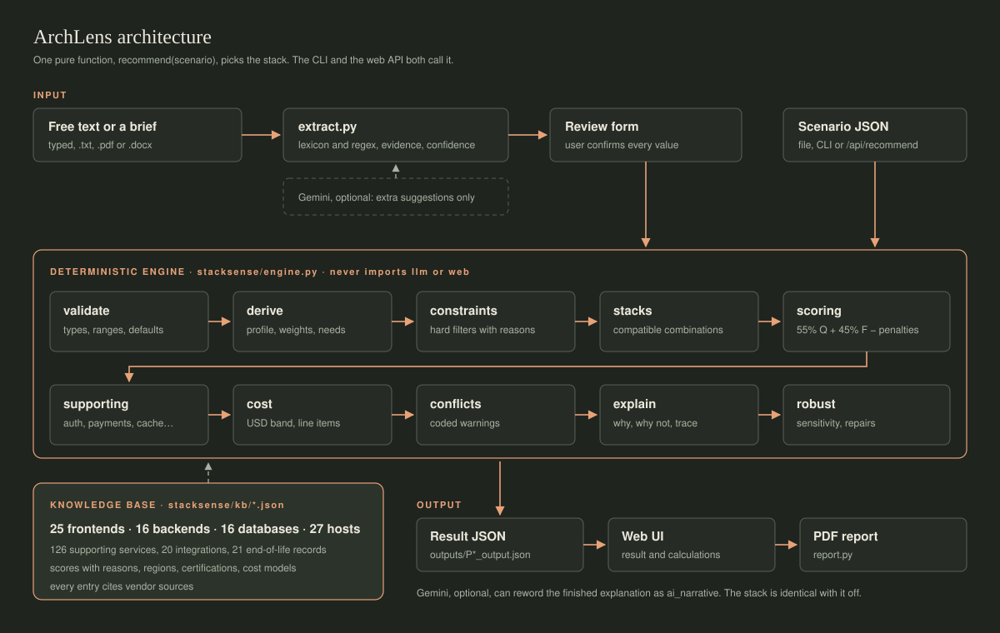

# ArchLens

Deterministic technology-stack recommender for the StackSense challenge (Synergy '26). Give it a project scenario, as a JSON file or a plain-language description, and it returns a justified stack: frontend, backend, database, hosting and supporting services, with an architecture style, a monthly cost band, coded warnings, the assumptions it made and a full decision trace.

**Live demo:** https://archlens-sxie.onrender.com (free hosting, so the first load after a quiet period can take about a minute; the local setup below is the reference).



## What makes it different

- **The engine decides, not an LLM.** One pure function, `recommend(scenario)`, filters and scores real products from a hand-written knowledge base. The same input gives the same stack, byte for byte.
- **Hard constraints are never broken silently.** Data residency, compliance, deployment model and an explicit cloud are filters with recorded reasons. If they cannot all be met, the result is `infeasible` with critical warnings and the single changes that would fix it.
- **Every pick is explained.** Each layer has a justification tied to the inputs that drove it, at least one alternative with the reason it lost, honest trade-offs, and the full score arithmetic on the Calculations page.
- **It fits the team, not the hype.** Team languages, experience, ops capacity and timeline are scored explicitly, so a Java team gets Spring Boot and a static site with two million readers stays static at $0.
- **It checks itself.** Each result re-ranks with every priority doubled and halved and the budget halved and doubled, and says how firm each pick is.

## Results on the public scenarios

| Scenario | Frontend | Backend | Database | Hosting | Style | USD / month |
|---|---|---|---|---|---|---|
| P1 Portfolio and blog | Astro | none (static) | none | Cloudflare Pages | static | 0 |
| P2 Home-services marketplace, India | React Native (Expo) + Next.js | Supabase | Supabase Postgres | Cloudflare Pages | serverless | 130 - 320 |
| P3 Real-time whiteboard SaaS, GDPR | React + Vite | Go (chi) | Cloud SQL PostgreSQL, Belgium | Google Cloud Run | modular monolith | 1,430 - 2,450 |
| P4 Digital lending, RBI and PCI DSS | React Native (Expo) | Java + Spring Boot | RDS PostgreSQL, Mumbai | AWS ECS on Fargate | modular monolith | 3,600 - 6,890 |
| P5 Internal HR tracker | Blazor | C# + ASP.NET Core | Azure SQL, Central India | Azure Container Apps | monolith | 78 - 190 |
| P6 Offline-first field survey | React Native (Expo) | Supabase | Supabase Postgres + PostGIS | runs on Supabase | serverless | 34 - 86 |

Full outputs are in [`outputs/`](outputs). Fifteen edge cases (air-gapped, contradictory constraints, budget too low, end-of-life systems, HIPAA, skill mismatch and more) are in [`outputs/edge/`](outputs/edge).

## Screenshots

| Start | Review with live checks |
|---|---|
|  |  |
| **Result (P4, lending fintech)** | **How the pick was earned** |
|  |  |
| **Warnings with codes and severity** | **Calculations** |
|  |  |

## Run it

Python 3.10 or newer. About two minutes on a normal connection; no API key or account needed.

```
cd source
python -m venv .venv
.venv/bin/pip install -r requirements.txt        # Windows: .venv\Scripts\pip install -r requirements.txt
.venv/bin/python run.py                          # Windows: .venv\Scripts\python run.py
```

Open http://127.0.0.1:8000, then pick a sample, describe a project, upload a brief (.pdf, .docx, .txt) or import JSON.

Command line, from `source/`:

```
python -m stacksense run scenarios/P2.json -o ../outputs/P2_output.json
python -m stacksense run-all scenarios ../outputs
```

Docker: from `source/`, run `docker compose up --build`.

## How it works



`validate` (types, ranges, documented defaults) -> `derive` (scale tier, ops capacity, criterion weights) -> `constraints` (hard filters with reasons) -> `stacks` (compatible combinations) -> `scoring` (55% quality + 45% fit, minus explicit penalties) -> `supporting` (auth, payments, cache, queue, search) -> `cost` -> `conflicts` (plain-language warnings) -> `explain` (why, why not, trace) -> `robust` (sensitivity checks).

The knowledge base in `source/stacksense/kb/` covers 25 frontends, 16 backends, 16 databases, 27 hosting options and 126 supporting services. Each entry has scored criteria with reasons, regions, certifications, cost models and cited vendor sources. End-of-life products are kept only to warn about them.

## Use of AI

Google Gemini is optional and used only for input parsing (turning free text into suggested form values that the user confirms) and for rewording the finished explanation. It never chooses, ranks or scores a technology. Switch it off with `STACKSENSE_LLM=off` or the toggle in the header; the stack is identical either way, and a test checks that the engine never imports the LLM code.

## Quality checks

- 236 automated tests: the schema of every output, hard constraints on every layer, byte-identical reruns, runs under different hash seeds, an LLM-off network check, perturbation tests that change one input at a time, and 150 seeded random scenarios.
- Answer-key benchmark on 40 briefs outside the public set: 91% of layer decisions expected or acceptable on the development set, and 97% on held-out briefs written afterwards.

## Repository

- [`source/`](source): application, knowledge base, scenarios, benchmark and tests. Full documentation (setup, architecture, technology versions, LLM switch, project structure, credits) is in [source/README.md](source/README.md).
- [`outputs/`](outputs): generated results for P1-P6 and the edge cases.
